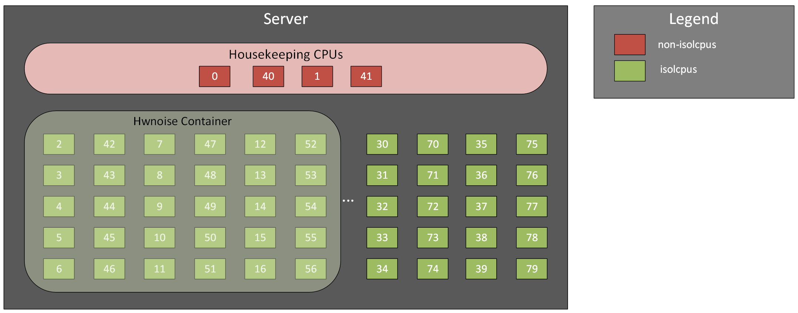
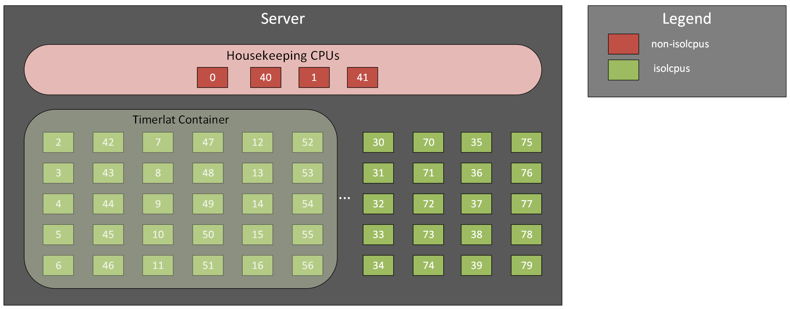

Appendix
========

The following section provides additional information on running the optional hwnoise as well as the timerlat test cases.

Hwnoise
-------

The following figure presents a diagram of the hwnoise workload running inside a container on the DUT. Note that the given core assignment is for example purposes only. When necessary the core assignment should be adjusted to account for the specific CPU installed in the System Under Test.

To run the hwnoise test case as a container on the DUT:

.. code-block:: yaml
		:linenos:
		   
		apiVersion: v1
                kind: Pod
                metadata:
                  name: hwnoise
                  annotations:
                    cpu-load-balancing.crio.io: "disable"
                    irq-load-balancing.crio.io: "disable"
                    cpu-quota.crio.io: "disable"
                spec:
                  # Map to the correct performance class in the cluster (from PAO)
                  # Identify class names with "oc get runtimeclass"
                  runtimeClassName: performance-openshift-node-performance-profile
                  restartPolicy: Never
                  containers:
                  - name: rtla
                    image: quay.io/container-perf-tools/rtla
                    imagePullPolicy: Always
                    resources:
                      requests:
                        memory: "200Mi"
                        cpu: "30"
                      limits:
                        memory: "200Mi"
                        cpu: "30"
                    env:
                    - name: tool
                      value: "rtla"
                    - name: COMMAND
                      value: "hwnoise"
                    - name: DELAY
                      value: "30"
                    - name: DURATION
                      value: "12h"
                    - name: AA_THRESHOLD
                      value: "30"
                    - name: EXTRA_ARGS
                      value: "--quiet"
                    securityContext:
                      # Required for access to /sys/kernel/debug on the host
                      privileged: true
                  nodeSelector:
                    node-role.kubernetes.io/worker: ""
                		
For the following test case:
   1. Execute the hwnoise case against 15 cores (30 threads) on the DUT.
   2. The test should run for a duration of 12 hours.
   3. Once the test completes record the maximum single latency value across all cores along with the percentage of CPU availability across all cores.

.. note::
    * Adjust the threads assigned to the CPU assignment parameters as needed based on the CPU installed within the platform.
    * It is not recommended to execute hwnoise against all available cores in the isolcpus list.
    * The AA_THRESHOLD should be set to the threshold at which the test should be halted. Once the threshold is hit, a trace will be collected and an auto-analysis will be performed to help determine the cause of the failure. In the example above the test will be halted when the threshold of 30 microseconds has been reached.

Timerlat
--------

The following figure presents a diagram of the timerlat workload running inside a container on the DUT. Note that the given core assignment is for example purposes only. When necessary the core assignment should be adjusted to account for the specific CPU installed in the System Under Test.

		      
To run the timerlat test case as a container on the DUT:

.. code-block:: yaml
		:linenos:
		   
		apiVersion: v1
                kind: Pod
                metadata:
                  name: timerlat
                  annotations:
                    cpu-load-balancing.crio.io: "disable"
                    irq-load-balancing.crio.io: "disable"
                    cpu-quota.crio.io: "disable"
                spec:
                  # Map to the correct performance class in the cluster (from PAO)
                  # Identify class names with "oc get runtimeclass"
                  runtimeClassName: performance-openshift-node-performance-profile
                  restartPolicy: Never
                  containers:
                  - name: rtla
                    image: quay.io/container-perf-tools/rtla
                    imagePullPolicy: Always
                    resources:
                      requests:
                        memory: "200Mi"
                        cpu: "30"
                      limits:
                        memory: "200Mi"
                        cpu: "30"
                    env:
                    - name: tool
                      value: "rtla"
                    - name: COMMAND
                      value: "timerlat"
                    - name: DELAY
                      value: "30"
                    - name: DURATION
                      value: "12h"
                    - name: AA_THRESHOLD
                      value: "30"
                    - name: EXTRA_ARGS
                      value: "--dma-latency 0"
     	            - name: EVENTS
                      value: "sched,timer,irq_vectors,irq,nmi,ipi"		      
                    securityContext:
                      # Required for access to /dev/cpu_dma_latency and /sys/kernel/debug on the host
                      privileged: true
                  nodeSelector:
                    node-role.kubernetes.io/worker: ""
                		
For the following test case:
  1. Execute the timerlat test case against 15 cores (30 threads) on the DUT.
  2. The test should run for a duration of 12 hours.
  3. Once the test completes record the maximum latency value along with the number of samples exceeding the threshold.

.. note::
    * Similar to cylcictest it is not recommended to execute timerlat against all available cores in the isolcpus list.
    * The AA_THRESHOLD should be set to the threshold at which the test should be halted. Once the threshold is hit, a trace will be collected and an auto-analysis will be performed to help determine the cause of the failure. In the example above the test will be halted when the threshold of 30 microseconds has been reached.
