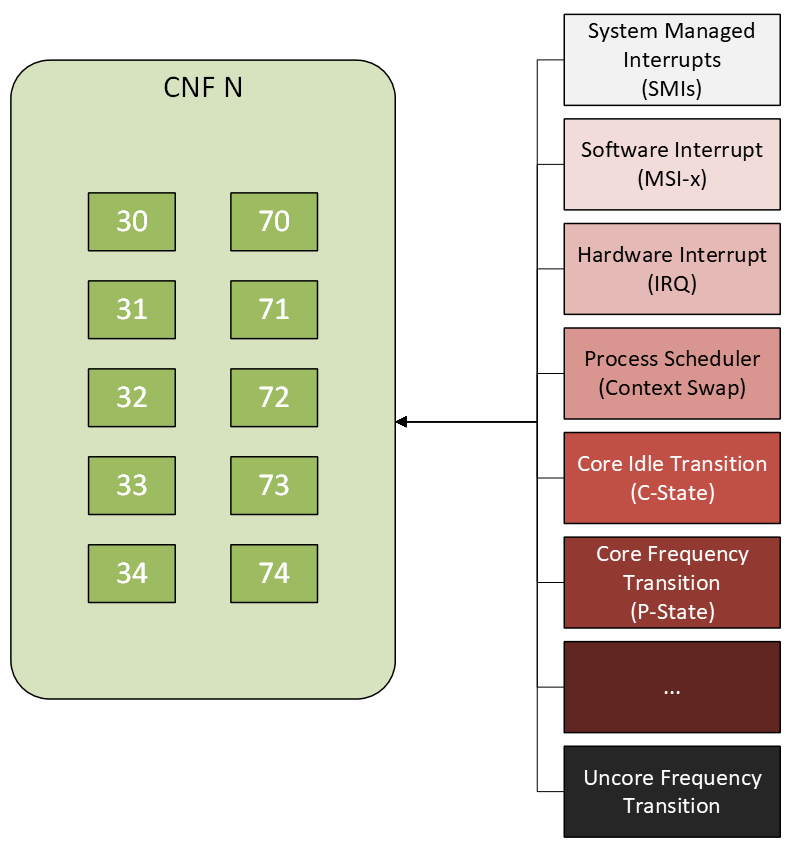
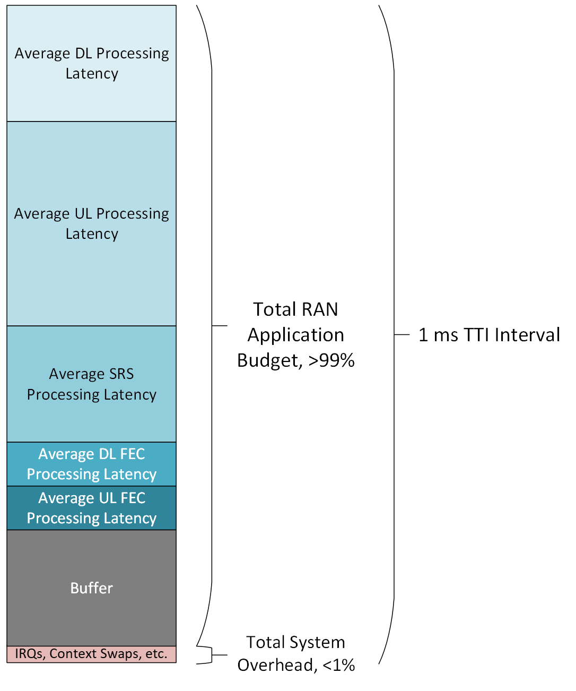

Background Information
======================

The following figure presents an overview of the various sources of noise that have the potential to perturb and add latency to the application cores assigned to a given CNF workload. Although this list is not comprehensive, it serves as an illustrative example of the types of noise sources that should be reduced when tuning a system for latency sensitive workloads.

One example of a noise source is an interrupt, which can be in the form of a software or hardware interrupt. One such class of an interrupt is a System Management Interrupt (SMI). An SMI is typically generated by the underlying hardware platform, for example proactively performing error correction of the memory DIMMs installed within the system. When an SMI event occurs it can interrupt all of the cores within the system and generate latencies on of the order of hundreds of microseconds. Where possible SMI events should be avoided and appropriately disabled within the BIOS settings of the platform.  Another class of an interrupt is a hardware Interrupt Request (IRQ). An IRQ is typically generated by a hardware component installed in the system, for example by an integrated LAN on Motherboard (LOM) controller whenever a management network packet arrives. In general, IRQs should be mapped to a subset of cores outside the list of cores assigned to the user space application. In a similar fashion, software interrupts, for example Message-Signaled Interrupts-Extended (MSI-X), where applicable should be assigned to a reserved set of cores outside the range of those assigned to the target CNF.

Another example of a noise source is a context swap, which is typically generated by the kernel process scheduler. In a multi-task operating system a given process is assigned to one or more cores. When the task completes the cores are reassigned to the next process to be executed. However, if the task does not complete within an allotted window of time, or the task is deemed to be idle, for example awaiting the completion of an I/O transaction, the kernel process scheduler can temporarily reassign the cores to another task in the queue. This core reassignment results in a context swap, which can be costly as it involves saving the current set of register values for the running process so that they may be restored at a later point. To try and avoid such context swaps, user space application cores are typically affined to a given set of cores that will run a single workload rather than multiple workloads. Furthermore, kernel threads are typically affined to a separate set of cores to avoid kernel processes being scheduled on such user space application resources. The same principles apply to other hardware resources assigned to a given workload to help ensure isolation, for example memory regions or even cache boundaries.

A third example of a source of noise in the system is a core idle transition, or C-state transition. A C-state transition is useful for the purposes of reducing power consumption particularly during more idle periods throughout a given 24 hour period. As an example, a highly utilized core may reside in C-states C0 or C1, indicating that the core is actively executing instructions. Conversely, a core with lower utilization may reside in C-state C6 to reduce power the overall power draw of the CPU, indicating that the core is not actively executing instructions. An idle state transition has an associated latency, with the latency having a given degree of variability. Although C-state transition times have been reduced with newer CPU generations, this indeterminate latency has the potential to introduce further levels of noise, particularly for cores assigned to a given workload. In general, Intel :sup:`®` Xeon :sup:`®` CPUs permit the allowable set of C-states to be configured on a per-core basis. For example, if desired, administrators can disable C-state C6 exclusively for the the cores assigned to a given application of interest, while having all available C-states enabled for the cores running kernel processes.

A fourth example of a noise source is a frequency transition, either in terms of a P-state transition or an uncore frequency transition. Similar to C-state transitions, a P-state, or equivalently a frequency bin, transition is useful for the purposes of reducing power consumption during more idle periods over the course of a 24 hour period. In addition, P-states can be used on a per core basis to opportunistically increase the frequency on a given set of cores, which in turn has the potential to increase the performance of the processes executing on the corresponding cores. Similar to C-state transitions, P-states transitions introduce a level of indeterminacy on the corresponding set of cores. Uncore frequency transitions are analogous to P-state transitions, except that the uncore acts at the level of a NUMA node rather than on a per core basis. In particular uncore frequency transitions can increase or decrease the rate at which the processor die performs I/O transactions with DIMMs accessible from a given memory controller, ethernet adapters accessible from a PCIe interface, and so forth. In general, Intel :sup:`®` Xeon :sup:`®` CPUs permit the allowable range of P-states to be configured on a per-core basis. Similarly, the uncore frequency can be configured on a per NUMA node basis within an allowable range of frequencies. For example, if desired, administrators can lock the frequency for a given set of cores assigned to a given application of interest, along with the frequency of the uncore. In contrast to C-states, the actual running frequency for the cores as well as the uncore is limited by a set of factors, such as the maximum rated Thermal Design Power (TDP) of a given CPU. As an example, if a given set of cores requests a set of P-states that would exceed the overall TDP of the CPU, the frequency will be throttled to ensure that the power consumed by the CPU does not exceed the rated TDP. Frequent P-state transitions introduces a level of jitter into the system, in which case the core and the uncore frequency are typically locked to a fixed value for latency sensitive workloads. Since latency sensitive workloads such as RAN applications make frequent use of the AVX512 instruction set, the core frequency is locked to the a pre-determined frequency that will avoid exceeding the TDP of a given CPU SKU. The uncore frequency is also locked to a pre-determined frequency that will similarly avoid exceeding the rated TDP of the CPU.

Although not explicitly shown, other containerized or virtualized workloads collocated on the same platform might also introduce a source of noise. The challenge of managing a myriad of workloads within the same multi-tenant environment is oftentimes referred to as the "Noisy Neighbor" problem. In this case, other CNFs and/or VNFs deployed onto the system, in particular those that are not isolated from other NFs, have the potential to impact any of the shared resources on the platform. For example, a CNF might generate a context swap for the cores assigned to another CNF, consume memory or storage resources from the pool, thrash the L1 or L2 cache, or consume all of the allotted bandwidth for a network interface. Any of these conditions can result in an unexpected latency spike for a mission critical CNF. In this case, administrators typically ensure that tenant isolation is in place so that each latency sensitive workload has its own set of dedicated resources that are not shared with other CNFs and/or VNFs deployed on the platform. In addition, limits might be placed on tenants in terms of the amount of allocated cores, memory, hugepages, network interfaces, and storage. This helps to reduce the impact of the noisy neighbor scenario.

The following figure presents a sample TTI budget allocation for a RAN application. In this example, a given 1 millisecond TTI interval is subdivided into time spent on RAN application related processing along with time spent on system related tasks. In an ideal scenario, RAN application processing time would account for 100% of the TTI interval, and the system related tasks would account for 0% of the TTI interval. The optimization goal is to reduce the system processing overhead to as close to 0% as is realistically possible. As shown in the diagram, the application is subdivided further into the typical set of tasks that would be carried out in a RAN scenario, such as DownLink (DL) processing, UpLink (UL) processing, Sounding Reference Signal (SRS) processing, along with Forward Error Correction (FEC) processing.

.. math::
   :name: Latency factors for a RAN application

   t_{RAN} = t_{DL} + t_{UL} + t_{SRS} + t_{FEC} 

Refer to the following table for the definitions of each term within this relation.

+-----------------+---------------------------------------------------------------------+
| Term            | Definition                                                          |
+=================+=====================================================================+
| :math:`t_{RAN}` | The amount of time spent by the RAN application                     |
+-----------------+---------------------------------------------------------------------+
| :math:`t_{DL}`  | The DL processing latency                                           |
+-----------------+---------------------------------------------------------------------+
| :math:`t_{UL}`  | The UL processing latency                                           |
+-----------------+---------------------------------------------------------------------+
| :math:`t_{SRS}` | The SRS processing latency                                          |
+-----------------+---------------------------------------------------------------------+
| :math:`t_{FEC}` | The aggregate FEC processing latency accounting for both UL and DL  |
+-----------------+---------------------------------------------------------------------+

In addition, the system overhead collectively represents the amount of time spent handling context swaps, SMIs, or any of the other potential sources of noise mentioned above.

.. math::
   :name: Latency factors for system related processing

   t_{system} = t_{SMI} + t_{NMI} + t_{MSI} + t_{IRQ} + t_{CS} + t_{IT} + t_{FT} + t_{UFT} + t_{NN}

Refer to the following table for the definitions of each term within this relation.

+--------------------+---------------------------------------------------------------------+
| Term               | Definition                                                          |
+====================+=====================================================================+
| :math:`t_{system}` | The amount of time spent on system overhead                         |
+--------------------+---------------------------------------------------------------------+
| :math:`t_{SMI}`    | The SMI processing latency                                          |
+--------------------+---------------------------------------------------------------------+
| :math:`t_{NMI}`    | The NMI processing latency                                          |
+--------------------+---------------------------------------------------------------------+
| :math:`t_{MSI}`    | The MSI-x processing latency                                        |
+--------------------+---------------------------------------------------------------------+
| :math:`t_{IRQ}`    | The IRQ processing latency                                          |
+--------------------+---------------------------------------------------------------------+
| :math:`t_{CS}`     | The context switch processing latency                               |
+--------------------+---------------------------------------------------------------------+
| :math:`t_{IT}`     | The idle transition processing latency                              |
+--------------------+---------------------------------------------------------------------+
| :math:`t_{FT}`     | The core frequency transition processing latency                    |
+--------------------+---------------------------------------------------------------------+
| :math:`t_{UFT}`    | The uncore frequency transition processing latency                  |
+--------------------+---------------------------------------------------------------------+
| :math:`t_{NN}`     | The latency introduced by all remaining noisy neighbor workloads    |
+--------------------+---------------------------------------------------------------------+ 
      
In order to safely avoid a TTI violation, at every instance of time the following relationship must hold true:

.. math::
   :name: 

   t_{RAN} + t_{system} < TTI

In particular, any time that is left over and not consumed either by the RAN application or the system is referred to as the buffer for a given TTI interval:

.. math::
   :name:

   t_{buffer} = TTI - (t_{RAN} + t_{system})

Where :math:`t_{buffer}` represents the amount of buffer time remaining within a given TTI interval.
   
Given that values above all represent instantaneous values that change from one TTI interval to the next, this variability implies that more or less time can be spent on any of the RAN or system related tasks mentioned above. Given this inherent variability, the goal of minimizing the latency due to system overhead also achieves the equally important goal of maximizing the amount of buffer for each TTI interval. The lower the system overhead, the greater the buffer, and in turn the greater the probability of avoiding a TTI violation.
      

	
.. note::

   * The previous diagram is not rendered to scale and is primarily for illustrative purposes only.
   * The latencies shown are instantaneous and do not include error bars that would indicate their standard deviations over multiple TTI intervals.
   * The latencies shown do not represent an exhaustive list of tasks that may be carried out in a given TTI interval.
