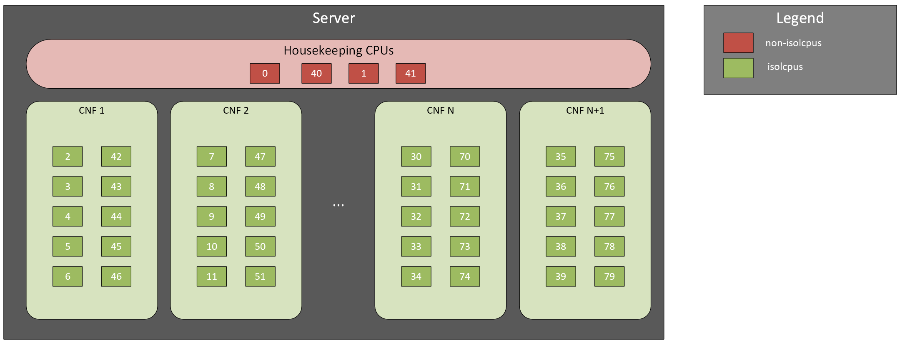
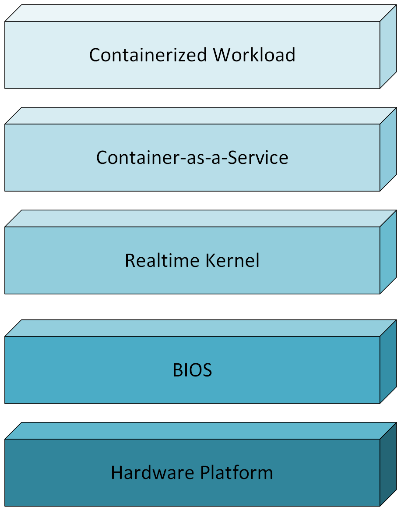

Problem Statement
=================

Overview
--------

In order to explore the challenges associated with deploying latency sensitive workloads in a Software Defined Network (SDN) on general purpose hardware in a deterministic fashion, an example use case is provided to walkthrough the overall process. Traditionally, a mission critical workload, such as a RAN application, would be deployed individually on a fixed function hardware appliance where a single tenant has sole ownership of the underlying hardware resources. However, with the advent of SDN, virtualization technology, and the desire to reduce overall Capital Expenditure (CapEx) and Operational Expenditure (OpEx), such Network Functions have transitioned to Virtualized Network Functions (VNFs) and Containerized Network Functions (CNFs) deployed in a multi-tenant fashion on commodity hardware. As part of this transition, the underlying multipurpose infrastructure, which previously would have been fixed function, no longer is guaranteed to meet pre-defined Key Performance Indicators (KPIs) in a deterministic fashion. Instead the system consists of a set of shared resources that must be tuned accordingly to a given tenant workload.

The following figure presents an example core layout for an Intel x86 CPU that supports HyperThreading. Notice that as part of this core layout a subset of the total available cores are reserved for the host operating system, while the remaining cores are reserved for the multi-tenant workloads to be deployed on the platform. In this case, the cores that are assigned to the operating system are part of the non-isolated CPU list, or non-isolcpus. These "housekeeping" threads handle the set of standard kernel related tasks, such as scheduling processes, allocating or freeing memory, servicing interrupts, and so forth. The cores that are assigned to the multi-tenant workloads are part of the isolated CPU list, or isolcpus. These application threads handle the tasks associated with the mission critical workloads. In general, the goal when tuning a system for latency sensitive workloads is to ensure that the resources, such as the application threads, are able to service their specific tasks within a given narrow window of time. For a vRAN application this is often with reference to the Transmission Time Interval (TTI), in which case any additional or potentially unrelated tasks that a given workload thread must handle subtracts from the overall allotted time for servicing a given TTI interval. In the context of vRAN, the TTI interval for a Narrowband use case is typically 1,000 microseconds, while for a MMIMO use case the TTI interval is typically 500 microseconds. The methodologies provided within this document are focused upon reducing the percentage of time spent by a given thread servicing tasks unrelated to meeting the target TTI interval, for example handling System Management Interrupts (SMIs).

System Level Tunable Layers
---------------------------
	 
The following figure presents an overview of the individual layers present within the Device Under Test (DUT). For each of these layers a set of tunings are applied in order to ensure that the system performs in a deterministic manner with the goal of meeting the required Service Level Agreement (SLA) defined by the workload.

Beginning with the foundational, the platform provided by the OEM manufacturer should be populated with a set of hardware ingredients designed to meet the stringent requirements for low latency application. For example, for RAN applications the specific CPU selected should support configurable P-states along with C-states, the AVX512 instruction set, and include a set of accelerators such as vRAN Boost for Forward Error Correction (FEC) hardware offload. The platform should allow populating the CPU in a single socket fashion in order to avoid the potential overhead associated with Non-Uniform Memory Access (NUMA). In addition, the memory channels in the platform should be populated in a single DIMM per Channel (DPC) fashion using dual rank memory modules with 8 banks (2Rx8). The platform should also support hardware offload of Precision Time Protocol (PTP) timestamping as well as a PTP Hardware Clock (PHC). The support for PTP hardware offload can be in terms of an integrated ethernet adapter, such as the Intel :sup:`®` E825 Ethernet Controller, or a discrete ethernet adapter, such as the Intel :sup:`®` E830 Ethernet Adapter.  Furthermore, the PHC can be implemented with the aid of a Digital Phase-Locked Loop (DPLL) discrete timing module, or as before as part of a discrete ethernet adapter. Optionally, the system can include support for connecting to a Global Positioning System (GPS) uplink that provides constellation and timing information by means of a Global Navigation Satellite System (GNSS) discrete module.

Proceeding to the Built-In Operating System (BIOS), the hardware platform provided by the OEM manufacturer should either (1) provide a workload profile specifically designed for applications such as RAN or (2) expose all of the necessary configurable settings required to meet the timing requirements for a latency sensitive application. For example, the BIOS should allow locking the uncore frequency of the CPU to the recommended value for a given SKU in order to reduce indeterminism in the system due to frequency transitions. In the context of RAN workloads, Intel :sup:`®`, in partnership with OEM manufacturers, periodically publishes the "BIOS Settings for FlexRAN™ Reference Architecture Platforms Based on Intel :sup:`®` Xeon :sup:`®` Processors Reference Guide". This BIOS guide is available for download from Intel Resource and Documentation Center in web based form as Document ID 861864, or as a standalone document as Document ID 861549.

Progressing to the Linux based Operating System, the system should be running a realtime kernel that supports preemption, specifically the PREEMPT_RT feature. The OS should be tuned such that the set of cores that are to be reserved for the workload application are isolated from the "housekeeping" related tasks of the kernel. The process of isolating cores varies between specific Operating System Vendors (OSVs), however in general the grub commandline is usually modified to specify a set of cores that should be placed in the isolcpus list.  In addition, the same set of cores are typically placed in the rcu_nocbs along with the nohz_full list. Respectively these settings remove the set of cores from the list of candidates that will perform Read-Copy-Update (RCU) callback operations, as well as excluding the set of cores from unbound timer callback executions. Furthermore, the irqaffinity setting is used to affine IRQs to the set of cores that will be dedicated to kernel related tasks. A similar set of tuning may also be applied through the use of services such as tuned that might layer their own workload profile onto the subset of cores that will be dedicated to running the given workload.

With regards to the Container-as-a-Service layer, the CaaS is typically based on a Kubernetes distribution and orchestrates the means by which the aforementioned tunings are applied along with automating the process of deploying the workload. Similar to the OS, the process can vary from between vendors, though in general a means is provided to generate and apply a workload profile to specify the tunings to be applied to the set of threads dedicated to the application in contrast to the kernel threads. In addition, the orchestrator usually provides a means to label a set of nodes as being suitable for realtime applications, which are then dedicated, for example, for the deployment of RAN workloads. In the context of Telco applications, the ability to separate nodes into groups based upon such labels allows Communication Service Providers and Mobile Network Operators to readily deploy workloads in a centralized fashion at scale based on the specific role, for example control or data plane, and tuning requirements, for example 5G core or 5G RAN.

Lastly, with regards to the containerized workload, this refers to the application provided by the Independent Software Vendor (ISV) that is ultimately deployed on a given CaaS platform. Although the containerized workload and the associated requirements vary between vendors, proxy workloads, such as FlexRAN™, can be used to approximate the performance of such latency sensitive applications. For example, with the Intel :sup:`®` FlexRAN™ reference application, a range of lightweight and more stressful test cases over a range of use cases, such as narrow band and massive MIMO (mMIMO), can be used to understand the corresponding range of performance of the underlying system. As previously mentioned, the key considerations in this case include the ability for the mission critical application to consistently meet TTI intervals, as well as the percentage of time spent on various tasks within a given TTI interval.

.. note::
   While the following guide focuses on vRAN as an example use case, the methodology provided should in general apply more broadly to other workloads. However, where applicable the specific tunings and measurement tools should be adjusted as needed for the actual workload under test. For example, there may be cases where not all of the suggested tools are required for a given workload.  Similarly, there may be cases where workloads have less stringent latency requirements and so a higher maximum latency can be tolerated.  Other workloads may not use as many CPU cores as what is detailed within the sample benchmarks, and so a lower number of cores can be assigned to a given measurement tool.
