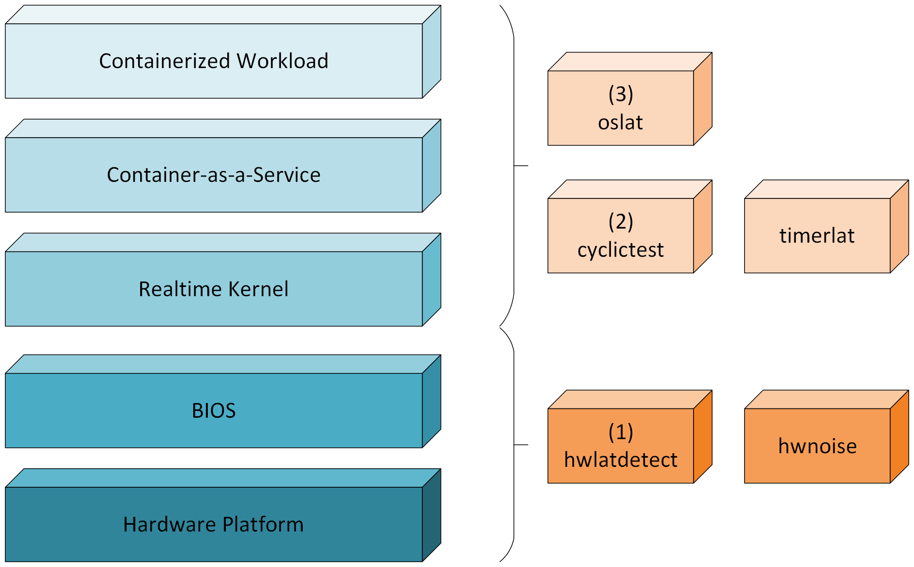

Measurement Tools
-----------------

This section provides details for the specific measurement tools of interest, for example cyclictest, oslat, hwlatdetect, hwnoise, and so forth, that are used to help quantify whether a system has been tuned for latency sensitive workloads. This list is intended to be comprehensive enough to provide a holistic picture of the amount of "noise", or lack thereof, within a given system, and in turn to assess the level of compliance for a given system to run such latency sensitive workloads, such as RAN, in a deterministic fashion. Each of the tool descriptions also includes a relevant link for interested readers to learn more.
This study includes the following measurement tools:

`hwlatdetect <https://man.archlinux.org/man/hwlatdetect.8.en>`_
   Designed to uncover latency issues caused by the underlying hardware or firmware,
   rather than the operating system itself.
   It temporarily suppresses most software activity to isolate and detect
   delays introduced by things like System Management Interrupts (SMIs),
   making it valuable for diagnosing platform-level latency issues.

`hwnoise <https://docs.kernel.org/tools/rtla/rtla-hwnoise.html>`_
   Focuses on detecting unpredictable latency caused by hardware-level noise,
   such as firmware activities.
   It monitors for irregular timing behavior that can disrupt real-time operations,
   helping to identify and mitigate sources of jitter that are otherwise hard to trace.

`cyclictest <https://man.archlinux.org/man/cyclictest.8.en>`_
   A widely used tool for measuring the wakeup latency of the Linux kernel's scheduler.
   It works by entering high-resolution sleeps and recording how long it takes
   for cyclictest to wake up once those sleeps expire.
   This helps evaluate how reliably and quickly the system can handle real-time tasks.

`oslat <https://man.archlinux.org/man/oslat.8.en>`_
   Measures gaps in the high-resolution timer under optional load by running multiple threads
   pinned to specific CPUs and timing their responses to scheduled events.
   It's particularly useful for understanding how latency behaves in multi-core environments,
   especially when the system is under stress or heavy workload.

`timerlat <https://docs.kernel.org/tools/rtla/rtla-timerlat-hist.html>`_
   Provides fine-grained insights into timer-related latency within the Linux kernel.
   By tracing the time between when a timer expires and when its handler actually runs,
   it helps developers and system integrators pinpoint delays
   that could affect real-time performance.

The following figure presents an overview of where each of tools mentioned above lies within the overall system under study. For example, the hwnoise and hwlatdetect tools are primarily targeted for measuring the latency and jitter introduced by the underlying hardware platform along with the relevant BIOS settings.  By contrast, cyclictest, oslat, and timerlat are primarily targeted for measuring the latency and jitter introduced by the kernel, the CaaS layer, along with other containerized workloads collocated within the multi-tenant environment. Included within this diagram is the recommended order in which each tool should be run.  Following the layered approach, tools such as hwlatdetect should be run first in order to identify any spikes related to hardware events, while tools such as oslat should be run last after the user has gained confidence that the lower layers are sufficiently tuned.

