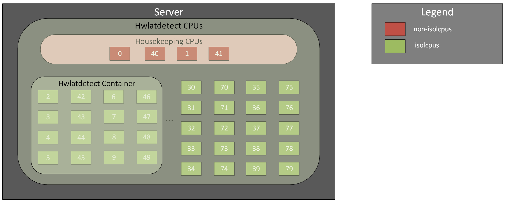
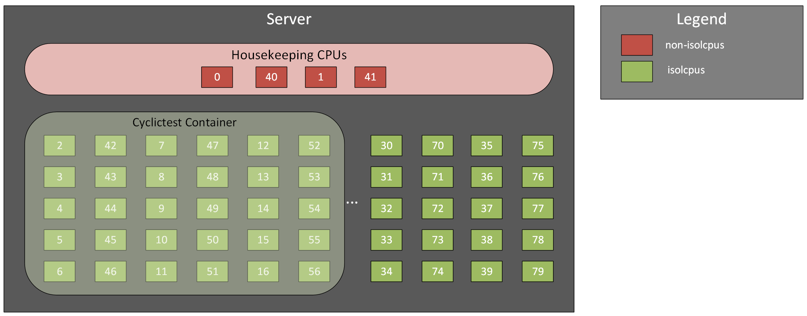
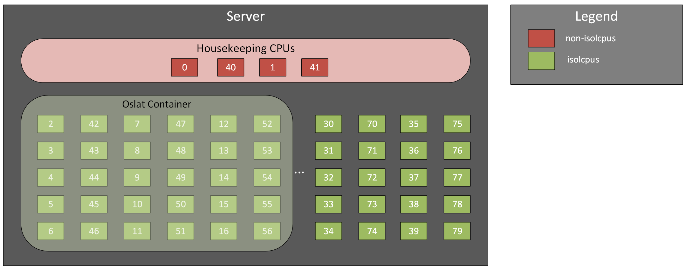

Measurement Tool Setup
======================

This section includes details for how each of the previously referenced measurement tools are deployed onto the platform along with guidance regarding their execution. Note that the order specified below aligns with the order in which each of the tools should be run. As previously mentioned, a layered approach should be adopted in which lower layers are certified first using tools like hwlatdetect. Only after a given test case passes should the user proceed to the next test case. If a given test case is not passing, the system should be reviewed to confirm that the appropriate tunings are in place. 

Hwlatdetect
-----------

The following figure presents a diagram of the hwlatdetect workload running inside a container on the DUT. Note that the given core assignment is for example purposes only. When necessary the core assignment should be adjusted to account for the specific CPU installed in the System Under Test.

To run the hwlatdetect test case as a container on the DUT:

.. code-block:: bash
		
                podman run -v $(pwd)/:/kubeconfig:Z \
		-e KUBECONFIG=/kubeconfig/kubeconfig \
		-e LATENCY_TEST_CPUS=16 \
                -e LATENCY_TEST_RUNTIME=43200 \
		-e MAXIMUM_LATENCY=15 \
                registry.redhat.io/openshift4/cnf-tests-rhel9:v4.20 \
                /usr/bin/test-run.sh --ginkgo.focus="hwlatdetect" --ginkgo.v --ginkgo.timeout="13h"		       
		       		       
For the following test case:
  1. The test should run for a duration of 12 hours.
  2. The test should specify a latency threshold of 15 microseconds.
  3. Once the test completes record the maximum latency value along with the number of samples exceeding the threshold.

Pass/Fail Criteria:
   * The DUT must demonstrate a maximum latency below the specified threshold, specifically with zero sampling events above the target threshold for cores in the isolcpus list.

.. note::
    * Although the LATENCY_TEST_CPUS is required by the hwlatdetect test case and determines where the container will run, the hwlatdetect test case will actually run on all available CPUs, including those not in the isolcpus list.
    * This test leverages the cnf-tests image, which is specific to RHOCP environments.
    * It is expected that the latencies can be higher on the cores in the non-isolcpus list.  If the samples above the target threshold occur on cores in the non-iscolcpus list is well above the maximum then this would warrant further investigation.
    * If the test case results for hwlatdetect are not meeting the specified criteria, the ancillary hwnoise test case can be run in order to debug the system further. Refer to the appendix for additional information on how to run the hwnoise test case.
    * For more information on running hwlatdetect please refer to `Performing latency tests for platform verification <https://docs.redhat.com/en/documentation/openshift_container_platform/4.20/html/scalability_and_performance/cnf-performing-platform-verification-latency-tests>`_.

Cyclictest
----------

The following figure presents a diagram of the cyclictest workload running inside a container on the DUT. Note that the given core assignment is for example purposes only. When necessary the core assignment should be adjusted to account for the specific CPU installed in the System Under Test.

To run the cyclictest test case as a container on the DUT:

.. code-block:: bash

                podman run -v $(pwd)/:/kubeconfig:Z \
                           --name=cyclictest \
                           -e KUBECONFIG=/kubeconfig/kubeconfig \
                           -e LATENCY_TEST_CPUS=30 \
                           -e LATENCY_TEST_RUNTIME=43200 \
			   -e LATENCY_TEST_DELAY=60 \
                           registry.redhat.io/openshift4/cnf-tests-rhel9:v4.20 \
                           /usr/bin/test-run.sh --ginkgo.focus="cyclictest" --ginkgo.v --ginkgo.timeout="13h"

For the following test case:
   1. The LATENCY_TEST_CPUS specifies the list of CPUs to test with the cyclictest command. Execute cyclictest against 15 cores (30 threads) on the system.
   2. The test should run for a duration of 12 hours (43,200 seconds).
   3. Once the test completes the cyclictest measurement tool will generate a histogram where each bin represents a specific latency value in microseconds. Record the histogram results.
   4. Based on the histogram calculate the number of samples at or below 10 microseconds expressed as a percentage.
   5. Based on the histogram calculate the number of samples at or below 30 microseconds expressed as a percentage.
   6. Based on the maximum latency value reported per thread, record the maximum latency across all threads.

Pass/Fail Criteria:
   * The DUT must demonstrate the system latency for the wake-up time of the threads to be at or below 10 microseconds for an aggregate percentage of 99.999%, with C-state C0 only enabled, and a latency at or below 30 microseconds for an aggregate percentage of 99.9999%.

.. note::
    * It is not recommended to run cyclictest against more than 15C30T on the system. Specifically it is not recommended to execute cyclictest against all available cores in the isolcpus list.
    * An aggregate percentage across all threads should be used when calculating the number of samples at or below 10 microseconds rather than individual percentages across each thread.
    * This test leverages the cnf-tests image, which is specific to RHOCP environments.
    * The LATENCY_TEST_DELAY will wait 60 seconds before starting cyclictest within the container.
    * If the test case results for cyclictest are not meeting the specified criteria, the ancillary timerlat test case can be run in order to debug the system further. Refer to the appendix for additional information on how to run the timerlat test case.
    
		      
    * For more information on running cyclictest please refer to `Performing latency tests for platform verification <https://docs.redhat.com/en/documentation/openshift_container_platform/4.20/html/scalability_and_performance/cnf-performing-platform-verification-latency-tests>`_.
      
Oslat
-----

The following figure presents a diagram of the oslat workload running inside a container on the DUT. Note that the given core assignment is for example purposes only. When necessary the core assignment should be adjusted to account for the specific CPU installed in the System Under Test.

To run the oslat test case as a container on the DUT:

.. code-block:: bash
		
		podman run -v $(pwd)/:/kubeconfig:Z \
		-e KUBECONFIG=/kubeconfig/kubeconfig \
                -e LATENCY_TEST_CPUS=30 \
		-e LATENCY_TEST_RUNTIME=43200 \
                -e LATENCY_TEST_DELAY=60 \
		-e MAXIMUM_LATENCY=30 \
                registry.redhat.io/openshift4/cnf-tests-rhel9:v4.20 \
                /usr/bin/test-run.sh -ginkgo.v -ginkgo.focus="oslat" --ginkgo.timeout="13h"

For the following test case:
  1. The LATENCY_TEST_CPUS specifies the list of CPUs to test with the oslat command. Execute oslat against 15 cores (30 threads) on the system.
  2. The test should run for a duration of 12 hours (43200 seconds).
  3. The test should specify a maximum latency (MAXIMUM_LATENCY) of 20 microseconds.
  4. Based on the histogram calculate the number of samples at or below 10 microseconds expressed as a percentage.
  5. Based on the histogram calculate the number of samples at or below 30 microseconds expressed as a percentage.
  6. Based on the maximum latency value reported per thread, record the maximum latency across all threads.

Pass/Fail Criteria:
   * The DUT must demonstrate a latency across all threads at or below 10 microseconds for an aggregate percentage of 99.999% and a latency at or below 30 microseconds for an aggregate percentage of 99.9999%.

.. note::
    * Similar to cyclictest, it is not recommended to run oslat against more than 15C30T on the system. Specifically it is not recommended to execute oslat against all available cores in the isolcpus list.
    * The LATENCY_TEST_DELAY will wait 60 seconds before starting cyclictest within the container.
    * This test leverages the cnf-tests image, which is specific to RHOCP environments.     
    * For more information on running oslat please refer to `Performing latency tests for platform verification <https://docs.redhat.com/en/documentation/openshift_container_platform/4.20/html/scalability_and_performance/cnf-performing-platform-verification-latency-tests>`_.
